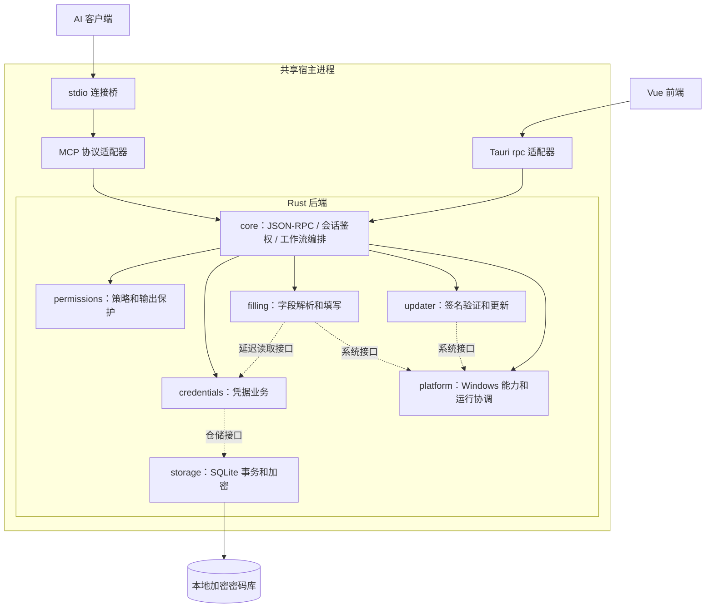

# 当前代码架构

后端按独立 Cargo crate 管理，核心编排跨模块操作。Tauri 与 MCP 是入口适配器，均调用同一个宿主内的 CoreSession；模块不是额外进程。



实线为编排调用，虚线为通过 contracts 中接口的运行时调用；虚线不代表两个功能 crate 直接依赖。core/bootstrap 注入具体实现。所有模块的可编译依赖由 `backend/architecture.json` 和 `npm run verify:architecture` 检查。

| 目录 | 职责 |
| --- | --- |
| frontend | 页面、交互状态、统一 RPC 客户端 |
| src-tauri | 窗口、托盘、启动和 IPC 适配，不实现凭据业务 |
| backend/core | 对外操作入口、身份绑定、执行门、跨模块工作流与依赖组装 |
| backend/contracts | DTO、错误、权限身份、操作和模块接口定义 |
| backend/credentials | 凭据校验、修改合并、批量业务策略 |
| backend/permissions | 默认/标签/凭据权限、事务授权策略、输出保护 |
| backend/filling | 凭据字段解析、文件模板和窗口填写用例 |
| backend/storage | SQLite 连接和事务、加密记录、标签和垃圾桶持久化 |
| backend/platform | UIA、SendInput、文件替换、进程、命名管道和暂停协调 |
| backend/updater | 更新元数据、签名、下载、健康检查、回退和安装编排 |
| backend/mcp | MCP 工具协议、参数适配、安全输出和 stdio 桥 |
| backend/common | JSON、路径、文件工具；不放业务策略 |

同一用户、EXE 和规范化数据目录共享一份后端。桌面与 MCP 使用不同身份的会话，但共享服务、执行门、输入目标和输出保护。连接桥不打开密码库。宿主生命周期由 Tauri 壳管理。

权限在每次操作执行时检查，不只在连接时检查。写入时仓储在事务中用最新设置重新执行注入的授权策略。SQLite 连接由 storage 长期持有并串行保护；填写目标检查后才调用延迟解析回调读取秘密。MCP 出口保护保留，不能读取明文或永久删除。

模块规则和测试归属见 [后端架构规则](../backend/ARCHITECTURE.md)，通信载荷见 [协议](PROTOCOL.md)。

## 六组 MCP 权限

在「MCP 管理 → 权限管理」的矩阵中配置，默认七列均开启（允许访问，加下列六类操作）：

| 权限 | 对应操作 |
| --- | --- |
| 读取元数据 | 搜索、按 ID 读取受控信息 |
| 新增凭据 | 新增单条或批量凭据 |
| 修改凭据 | 更新单条或批量凭据 |
| 移入垃圾桶 | 核对版本后逻辑删除 |
| 填写到窗口 | 捕获目标及统一窗口写入 |
| 写入文件 | 新建文件或替换明确占位符 |

窗口填写与文件写入分别鉴权，共享的 `write_credential` 按真实目标类型判断。两项都关闭时，该工具不再列出。配置查询不属于这六组，但仍受 MCP 总开关控制。

每次工具发现和操作执行都读取最新持久化设置，已建立连接的后续调用立即受新策略约束；正在执行的已授权操作不追溯撤销。客户端若缓存工具清单，可能需要刷新清单，但旧清单中的调用仍会被核心拒绝。

权限修改、原文读取、系统剪贴板、启动设置、垃圾桶查看、永久删除和在线更新固定不对 MCP 开放。MCP 的恢复、置顶和标签管理沿用修改权限及对象范围校验。关闭总开关会拒绝全部后续 MCP 操作。新密码库默认六组权限均开启，设置使用完整的当前结构。

永久清空由核心收集垃圾桶快照，调用 Windows 服务显示原生确认框（默认取消），确认后核验快照再删除。既不能传一个 `confirmed=true` 绕过，也不能通过 MCP 调用该操作。

存储层调用加密再执行 SQL；加密模块不负责存数据库。ID、版本、时间等结构元数据保持可查询，凭据内容加密保存。填写服务内部使用同一存储服务中的密码库。Windows 能力服务不持有密码库；输入方法接收延迟解析回调，先验证目标，再解析凭据，输入前再次核对焦点。原来的目标有效期、一次性消费、按键缓冲清零与秘密清零保持不变。文件模板、占位符、冲突检测与暂存文件清理属于填写服务，`ReplaceFileW` 由 Windows 能力服务封装。DPAPI 绑定和数据库版本保持原有约定。

## 验证

```powershell
cargo test --workspace --locked
npm run desktop:build
npm run verify:permissions
npm run verify:integration
node scripts/verify-write.mjs
```

核心测试直接使用 MCP 身份调用仅限桌面的操作，证明误路由也被拒绝，并覆盖六组权限、撤销/恢复、跨会话可见性、版本冲突、删除后禁止填写和返回投影。

原生 WebView2 测试实际勾选默认权限矩阵并保存并检查持久化、恢复、命中和窄窗口布局。MCP 线路测试使用保持连接的真实 stdio 客户端；在隔离密码库中注入持久化策略变更，模拟另一个桌面进程保存权限，验证工具发现和执行同步受约束。所有测试均使用临时目录与虚构凭据。

## 标签与对象权限

默认只显示默认规则；「按标签单独设置」展开同一表格中的标签，再展开标签显示对应凭据。展开、收起仅改变显示，不改变授权。无标签凭据也可配置单条例外；同一凭据出现在多个标签下时，共用同一个 ID 的规则。

每项操作单独计算：单条显式设置优先；多个标签的显式规则冲突时禁止优先；没有显式规则则继承默认。允许访问与具体操作同时通过才可执行。MCP 总开关和固定禁止边界优先于所有对象规则。

生效预览调用核心 `PermissionPreview`，不是在 Vue 中另写一套授权算法。该操作只允许桌面身份调用，不向 MCP 暴露。标签、单条规则以 AES-GCM 加密后保存，规则键不会以明文落到 SQLite 或 WAL。标签改名/删除同步更新活动条目、垃圾桶、标签目录和规则，使用同一事务。

搜索先按对象权限过滤，再对元数据脱敏后匹配。批量读含未授权对象时拒绝整批。批量新增、更新、移入垃圾桶在 SQLite 写事务内部读取当前规则并检查所有对象；任何一项失败则回滚。修改前后的范围都需授权；MCP 不能通过修改标签给自身增加权限。单条创建按拟创建条目的标签计算，不支持单条 ID 创建规则。

## 当前数据格式

程序仅创建和读取 schema=4 密码库，不包含旧版升级或迁移器。旧 schema=1/2/3 在只读检查阶段被拒绝，不修改文件、不自动初始化。加密记录只包含标签，接口不接受 group；API 服务地址通过 services 明确保存，url 仅作为首个地址的派生摘要。协议仅支持 OpenAI、Anthropic、Gemini 和 custom。

现有数据先在程序外一次性转换，保留转换前的加密备份，并验证所有凭据字段和密钥、垃圾桶、标签目录及权限规则。转换工具和含用户数据的转换结果均不随源码或发行包分发。当前 AES-GCM 的 AAD 和 DPAPI 标识是加密格式的一部分，不是旧版兼容分支。

## 在线更新

更新操作通过统一 Operation 接口，在核心被固定为 DesktopOnly。更新服务编排检查、下载与验签，Windows 能力服务执行进程启动。只有唯一后端持有核心运行锁，更新需取得独占锁。详细发布协议、数据保护、失败回退和验证边界见 [UPDATES.md](UPDATES.md)。

## 更新期间的 MCP 生命周期

更新协调按 EXE 路径覆盖所有相关连接和数据目录。连接桥先拒绝新请求并等待已有请求完成，关闭内部管道；后端确认所有 MCP 连接排空后确认暂停。没有桌面窗口的宿主退出并释放运行锁；有窗口的宿主保留桌面，供安装器自动关闭、替换并重启。原 stdio 连接桥保持不变，升级成功或回退后恢复协议握手；写请求不重放。

在线更新在取得核心独占执行门之前先排空 MCP，避免已排队请求等待同一个执行门造成死锁。界面关闭时，如果还有 MCP 连接，后台继续运行；重新打开界面复用原宿主。没有界面和客户端时，宿主空闲 5 秒后退出。明确的托盘退出和更新重启会退出当前宿主；仍在线的连接桥按原机制重连并按需启动后台。

命名管道限定当前用户和系统账户，拒绝远程连接。桌面二次启动使用独立的激活通道，只接受同用户、同 EXE 的进程发送 `show` 或 `background`；不接受操作、身份、路径或凭据载荷。MCP 的业务请求始终进入固定 MCP 身份的适配器。

## 浏览器填写目标（0.5.6）

`CaptureTarget(CaptureRequest)` 和填写操作均先经过核心权限服务，再进入填写服务。`core/windows/input/locator.rs` 仅在本地按窗口标题、可选进程 ID 和输入框可访问名称定位唯一 Edit 控件，检查密码类型、可编辑性后取得原生焦点；不会读取控件值。UIA 查询有超时和并发限制，工作线程仅定位和聚焦，不持有或输入凭据。

定位成功返回 30 秒有效的一次性目标。实际写入仍由`core/windows/input.rs` 完成：解密前后校验前台窗口、原生焦点及 UIA Runtime ID，不符合就拒绝。无参数捕获用于记事本、编辑器、终端等原生焦点路径。`input_sent` 只表示系统接收了键盘事件；浏览器验收单独检查实际 DOM 值及可信输入事件，不能把事件发送当成网页填写成功。

## 图中的包含关系

最外层边框是唯一 Rust 后端进程，包含桌面适配器、MCP 适配器和 Rust 核心。核心边框包含统一接口、权限服务、存储、填写、Windows 能力和更新服务。存储模块再包含加密密码库实现。客户端和 stdio 连接桥位于宿主边框外；箭头表示调用，不代表包含。

## 安装和更新的私有启动入口

`main.rs` 在普通核心会话建立前分流 `--installer-replace` 和 `--apply-update`，分别进入 `core/installer.rs` 与 `core/updater.rs` 的启动编排。这些入口用于程序文件替换、回退和重启，不是 MCP 工具，也不通过普通 `Operation` 接口。Windows 进程操作仍位于 `core/windows/`。安装器只把 `vault.desktop` 主窗口类视为桌面窗口，再核对同用户、同 EXE 路径及进程创建时间；COM、IME 和无窗口事件目标不进入重启列表。

交互架构图保存在 `docs/prototypes/architecture.html`，源规格为同目录的 `architecture.json`。图中的统一核心同时表示代码复用和运行时共享：桌面与 MCP 在同一宿主中持有身份隔离的会话，共享一份核心服务实例。

## 单后端实测

先运行 `node scripts/tauri.mjs build --debug --no-bundle`，再运行 `node scripts/verify-unified-backend.mjs`。它在隔离目录启动实际 Tauri WebView 与两个 MCP 客户端，分别验证桌面先启动和 MCP 先启动、唯一后台 PID、双向读写、实时权限撤销与恢复、激活通道拒绝其他进程、关闭和重开窗口不重建后台。报告为 `artifacts/unified-backend-verification.json`。调试端口仅存在于显式指定端口的 debug 构建，正式版没有该入口。

## 可重复的本地验收

运行 `node scripts/tauri.mjs build --debug --no-bundle` 后，执行 `npm run verify:regression`。该命令串行执行 MCP/桌面、权限、更新连接保留、共享宿主、原生编辑器与 Edge 密码框测试，避免并行测试争夺焦点。通过 VAULT_EXE 可指定同一构建的副本。测试均创建隔离目录，只使用虚构凭据。日志和带 EXE SHA-256 的汇总保存在 artifacts/regression/。

在线更新完整替换/回退另用 scripts/verify-update.mjs，需要两个独立版本的 debug 构建和本机已配置的签名密钥；安装覆盖测试用 scripts/verify-installer-handoff.mjs。报告只证明对应本地构建，不等同于远程 CI 或已发布版本。
